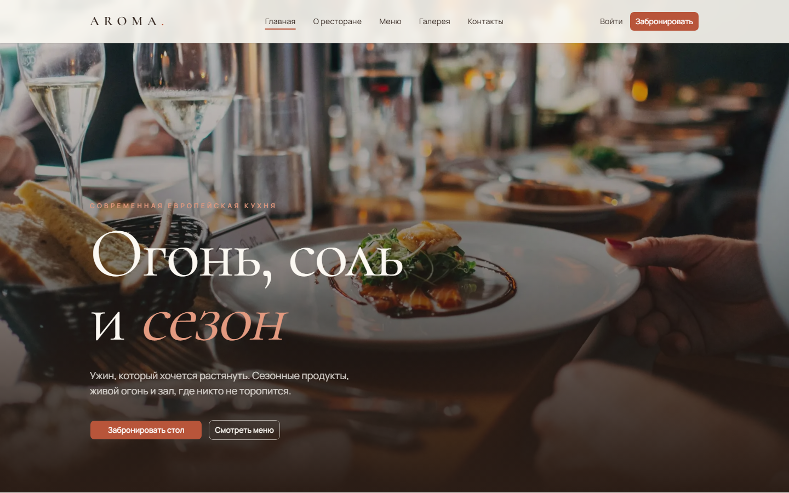
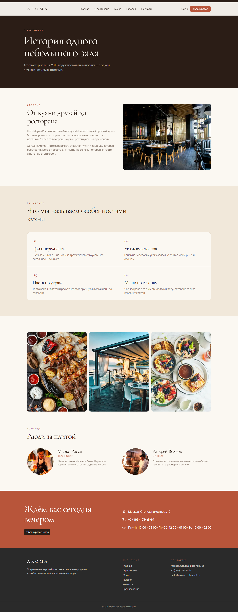
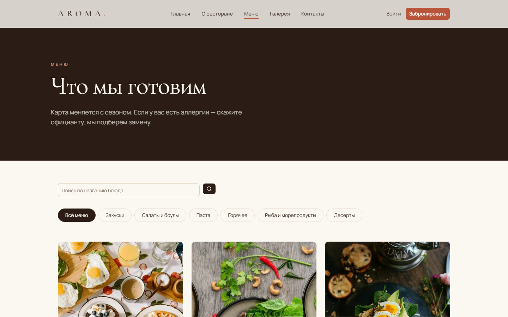
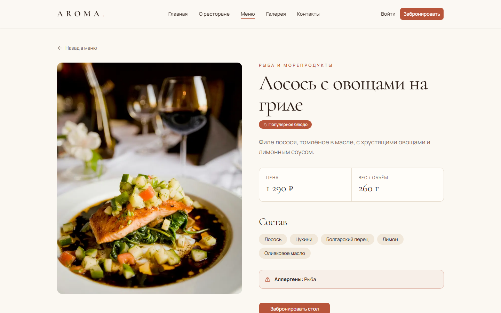
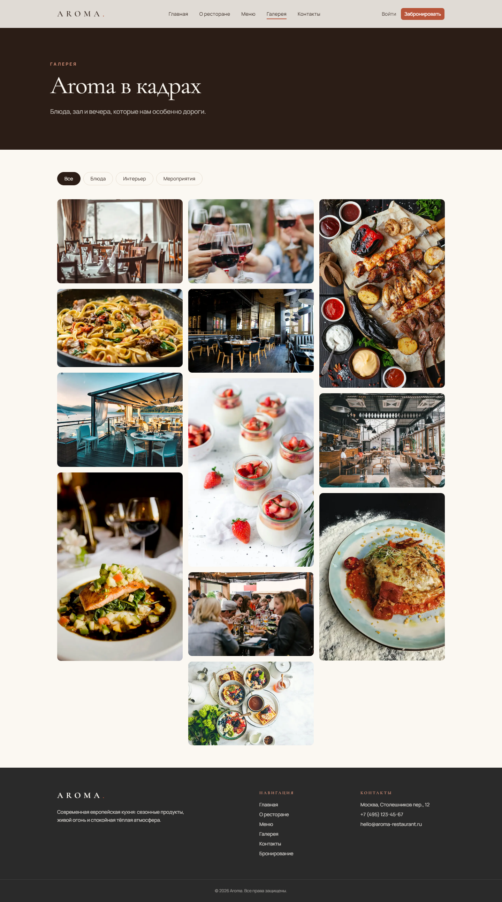
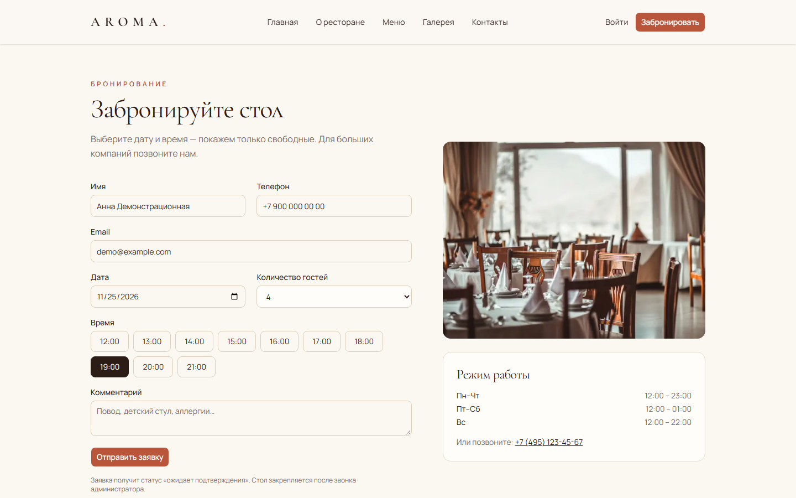
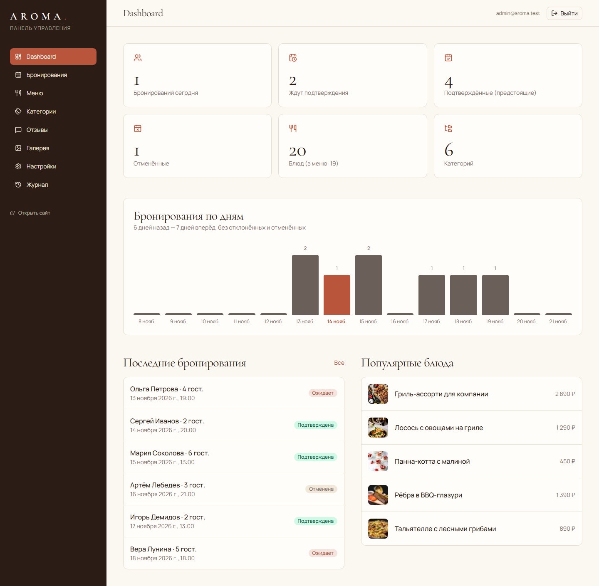
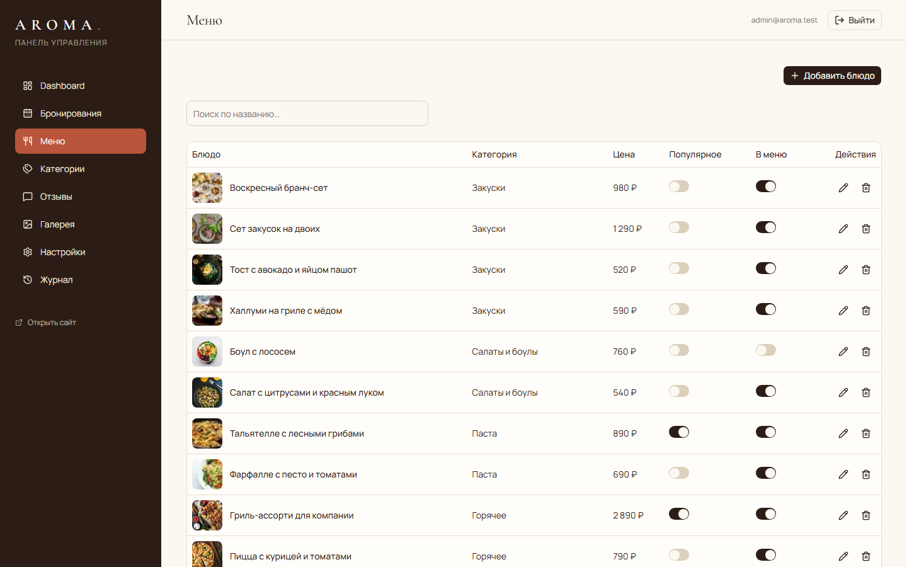
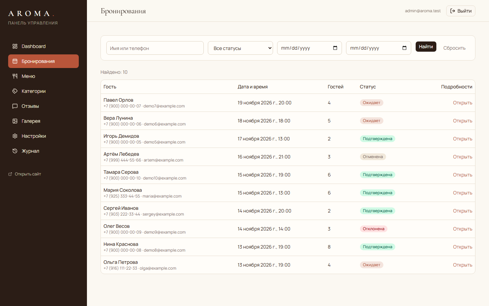
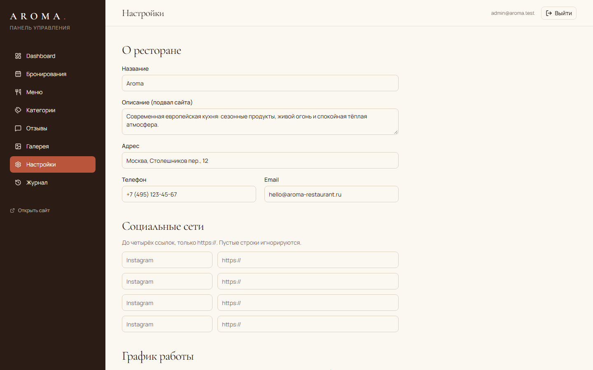

# Aroma — сайт и панель управления рестораном

Демонстрационный коммерческий проект: публичный сайт вымышленного ресторана современной европейской кухни
с меню, онлайн-бронированием столов, контактной формой и полноценной админ-панелью.

> **Aroma — вымышленный ресторан.** Меню, цены, отзывы, имена гостей и телефоны придуманы. Фотографии — с
> [Unsplash](https://unsplash.com) (лицензия Unsplash). Письма и SMS **не отправляются**, онлайн-оплаты **нет**.

<p align="center">
  
</p>

## Содержание

[Концепция](#концепция) · [Возможности](#возможности) · [Стек](#стек-технологий) · [Архитектура](#архитектура) ·
[Структура папок](#структура-папок) · [Скриншоты](#скриншоты) · [Требования](#требования) ·
[Локальный запуск](#локальный-запуск) · [Neon](#neon-postgresql) · [Drizzle и миграции](#drizzle-orm-и-миграции) ·
[Better Auth](#better-auth) · [Cloudinary](#cloudinary) · [Переменные окружения](#переменные-окружения) ·
[Тесты](#тесты) · [Vercel](#публикация-на-vercel) · [Статус проверки](#что-проверено-и-что-нет) · [Ограничения](#ограничения-и-необходимые-интеграции)

## Концепция

«Огонь, соль и сезон». Премиальный минимализм: молочный и кремовый фон, эспрессо и графит, терракотовые акценты,
выразительная антиква (Cormorant Garamond) в паре с Manrope, крупные фотографии блюд и зала, спокойные анимации
появления. Сайт должен выглядеть как проект студии, а не как шаблон кафе.

## Возможности

**Публичный сайт**
- Главная, «О ресторане» (история, особенности кухни, команда), галерея с фильтрами и просмотром фото.
- Меню из базы данных: категории, поиск по названию, карточки с фото, состав, вес, цена, аллергены, «популярное»,
  похожие блюда. Отключённые блюда скрыты (в списке и по прямой ссылке — 404).
- **Бронирование**: валидация (Zod) на клиенте и на сервере, запрет прошлых дат, график работы по дням недели
  (в т. ч. работа после полуночи), длительность брони, вместимость зала и лимит одновременных броней,
  показ только свободных интервалов, защита от двойной отправки (ключ идемпотентности), защита от гонок
  (транзакция + advisory lock), лимит заявок с одного IP, страница «Заявка принята».
  Статусы: `pending → confirmed / rejected / cancelled`; автоподтверждения по умолчанию нет.
- Контактная форма (телефон или email + сообщение), скрытое поле-ловушка и лимит сообщений.
- Отзывы: на сайте только опубликованные.
- Регистрация, вход, выход, восстановление пароля, личный кабинет со своими бронями.

**Админ-панель** (`/admin`, только роль `admin`)
- Dashboard: брони сегодня / ожидающие / подтверждённые / отменённые, число блюд и категорий, последние брони,
  популярные блюда, график по дням — всё считается SQL-запросами по реальным данным.
- Бронирования: поиск по имени и телефону, фильтры по статусу и дате, карточка брони, подтверждение, отклонение, отмена,
  перенос (с теми же проверками графика и вместимости), комментарий администратора.
- Меню: создание, редактирование, удаление с подтверждением, несколько фото через Cloudinary, главное фото, порядок.
- Категории: создание, правка, порядок; удаление категории с блюдами невозможно.
- Галерея: загрузка, замена, удаление, порядок, главное фото.
- Отзывы: публикация, скрытие, удаление, средняя оценка и распределение.
- Настройки: название, описание, адрес, контакты, график, правила бронирования, соцсети.
- Журнал действий: кто, когда и что изменил (только изменённые поля, без секретов).

## Стек технологий

| Слой | Технологии |
| --- | --- |
| Фронтенд | Next.js 16 (App Router), React 19, TypeScript, Tailwind CSS 4, shadcn/ui, Lucide |
| База данных | **Neon PostgreSQL**, **Drizzle ORM** (HTTP-драйвер + WebSocket-пул для транзакций) |
| Авторизация | **Better Auth** (email + пароль, сессии в БД), роли `customer` / `admin` в таблице `user_roles` |
| Изображения | **Cloudinary** (серверная загрузка, URL и `public_id` в PostgreSQL) |
| Валидация | **Zod** (форма → server action → БД) |
| Тесты | Playwright, встроенный PostgreSQL (`embedded-postgres`), PGlite |
| Хостинг | Vercel |

## Архитектура

```
Браузер ── RSC / Server Actions / Route Handlers ──► services/* ──► Drizzle ──► Neon PostgreSQL
                 │                                        ▲
                 ├── Better Auth (/api/auth/*) ───────────┘ (users, sessions, accounts, verifications)
                 └── /api/admin/images ──► Cloudinary (секрет только на сервере)
```

- `services/*` — чтение/запись предметной области без привязки к Next.js. Правила бронирования — в `lib/booking.ts`
  (чистые функции) и `services/reservations.ts` (транзакция).
- `actions/*` — тонкий слой: **проверка роли на сервере → Zod → сервис**. Интерфейс ничего не решает: скрытая кнопка
  не защита, каждая операция вызывает `assertAdmin()` (роль читается из БД).
- Страницы админки закрыты в `layout`, а каждая приватная выборка проверяет роль ещё раз (layout не перерисовывается
  при клиентской навигации).
- Роль `admin` выдаёт только скрипт `npm run admin:create`; регистрация всегда создаёт `customer`.
- Брони при конкурентных запросах: `pg_advisory_xact_lock` на дату → проверка вместимости → вставка в одной транзакции.

**Таблицы (15):** `users`, `sessions`, `accounts`, `verifications`, `profiles`, `user_roles`, `menu_categories`,
`menu_items`, `menu_item_images`, `reservations`, `restaurant_settings`, `reviews`, `gallery_images`,
`contact_messages`, `audit_log`. Миграции: `drizzle/0000_init`, `0001_booking_engine`, `0002_admin_panel`.

## Структура папок

```
src/
  app/
    (public)/        публичные страницы, вход/регистрация, кабинет
    admin/           админ-панель
    api/             auth, health, admin/images, reservations/availability
  actions/           server actions (формы, админские операции)
  components/        ui (shadcn), shared, public, admin
  config/            сайт, правила бронирования по умолчанию
  data/              демо-данные для seed (меню, отзывы, галерея, брони)
  db/                подключение, схема Drizzle, seed
  lib/               auth, session/roles, booking, cloudinary, validations (Zod), email-шлюз
  services/          catalog, reservations, admin
  types/
drizzle/             SQL-миграции
scripts/             seed, create-admin, verify-* (оффлайн-проверки)
e2e/                 Playwright-тесты и тестовая инфраструктура
docs/                DEMO.md, скриншоты
```

## Скриншоты

Сделаны из работающего приложения (`npm run test:shots`) на демо-данных.

| | |
| --- | --- |
|  Главная |  О ресторане |
|  Меню |  Карточка блюда |
|  Галерея |  Форма бронирования |
|  Dashboard |  Управление блюдами |
|  Управление бронированиями |  Настройки |

## Требования

- Node.js **20.9+**, npm
- Аккаунты (для запуска на реальной инфраструктуре): Neon, Cloudinary, Vercel
- Для локального запуска без внешних сервисов аккаунты не нужны — см. [docs/DEMO.md](docs/DEMO.md)

## Локальный запуск

**Вариант 1 — без внешних сервисов** (временный PostgreSQL + заглушка Cloudinary): пошагово в
[docs/DEMO.md](docs/DEMO.md#a-полностью-локально-без-внешних-сервисов-5-минут).

**Вариант 2 — с вашими Neon и Cloudinary:**

```bash
git clone <репозиторий> aroma && cd aroma
npm install
cp .env.example .env.local        # заполните значения (см. таблицу ниже)
npm run db:migrate                # применить миграции к Neon
npm run db:seed                   # демо-данные (идемпотентно)
ADMIN_EMAIL=you@example.com ADMIN_PASSWORD='не-короче-12-символов' npm run admin:create
npm run dev                       # http://localhost:3000
```

## Neon PostgreSQL

1. Создайте проект на [neon.tech](https://neon.tech), выберите регион рядом с регионом функций Vercel.
2. На странице подключения скопируйте две строки:
   - **pooled** (с `-pooler` в хосте) → `DATABASE_URL` приложения;
   - **direct** (без `-pooler`) — для запуска миграций (`DATABASE_URL` на время `npm run db:migrate`).
3. Строка содержит `sslmode=require` — оставьте как есть.

Приложение использует HTTP-драйвер Neon (`@neondatabase/serverless`) для обычных запросов и WebSocket-пул — только для
транзакции бронирования.

## Drizzle ORM и миграции

- Схема: `src/db/schema/*.ts`, конфигурация: `drizzle.config.ts`, миграции: `./drizzle`.
- Изменили схему → `npm run db:generate` → проверьте SQL → `npm run db:migrate`.
- `npm run db:studio` — веб-интерфейс Drizzle Studio.
- Все запросы параметризованы (Drizzle), «сырой» SQL используется только с параметрами `sql\`...\``.

## Better Auth

- Сгенерируйте секрет: `openssl rand -base64 32` → `BETTER_AUTH_SECRET`.
- `BETTER_AUTH_URL` — публичный адрес сайта (локально `http://localhost:3000`).
- Таблицы Better Auth — `users`, `sessions`, `accounts`, `verifications` (UUID, множественные имена через `usePlural`).
- Сессия — 7 дней; вход, регистрация и сброс пароля ограничены по частоте самой библиотекой (ответ 429).
- Письмо для сброса пароля: **провайдер не подключён**. В разработке ссылка печатается в консоль сервера, в production
  письмо не отправляется (в логе будет ошибка). Подключите Resend/SMTP в `src/lib/email.ts`.
- Первый администратор: `npm run admin:create` (пароль задаёте вы, в репозитории его нет).

## Cloudinary

1. В [Dashboard](https://console.cloudinary.com) возьмите Cloud name, API Key, API Secret.
2. Задайте `CLOUDINARY_CLOUD_NAME`, `CLOUDINARY_API_KEY`, `CLOUDINARY_API_SECRET`.
3. Загрузка идёт через защищённый `POST /api/admin/images` (только `admin`): проверяются тип по сигнатуре файла
   (JPEG, PNG, WebP, AVIF) и размер (до 8 МБ). Секрет не попадает в браузер; в БД сохраняются `url`, `public_id`,
   размеры и формат. Замена и удаление чистят старый файл в Cloudinary.
4. Фото демо-меню в seed — внешние ссылки Unsplash (без `public_id`); всё, что вы загрузите, хранится в Cloudinary.

## Переменные окружения

| Переменная | Обязательна | Назначение |
| --- | --- | --- |
| `DATABASE_URL` | да | строка подключения Neon (pooled для приложения) |
| `BETTER_AUTH_SECRET` | да | секрет подписи сессий (в production без него приложение не работает) |
| `BETTER_AUTH_URL` | да | публичный URL сайта |
| `CLOUDINARY_CLOUD_NAME`, `CLOUDINARY_API_KEY`, `CLOUDINARY_API_SECRET` | для загрузки фото | доступ к Cloudinary (только сервер) |
| `DEMO_MODE` | нет | `true` — показать в подвале пометку «демонстрационный проект» |
| `ADMIN_EMAIL`, `ADMIN_PASSWORD`, `ADMIN_NAME` | только для `admin:create` | данные первого администратора (пароль ≥ 12 символов) |
| `DB_DRIVER`, `CLOUDINARY_URL`, `CLOUDINARY_UPLOAD_PREFIX` | только тесты/локальный демо-режим | обычный PostgreSQL и заглушка Cloudinary |

`.env*` игнорируется git; в репозитории только `.env.example` без значений.

## Тесты

```bash
npm run typecheck        # TypeScript
npm run lint             # ESLint
npm run verify:local     # схема, миграции, seed, бронирование, Better Auth — на PGlite
npm run verify:admin     # доменный слой админки на PGlite
npm run verify:upgrade   # миграции 0001–0002 на базе со старыми данными
npm run test:e2e         # Playwright: сборка приложения + реальный PostgreSQL + заглушка Cloudinary
npm run test:shots       # перегенерировать скриншоты в docs/screenshots
```

`test:e2e` сам поднимает всё необходимое (PostgreSQL из пакета `embedded-postgres`, заглушку Cloudinary, production-сборку
приложения, а также копию приложения с недоступной БД для проверки деградации). Покрытие: 175 тестов проходят в последнем полном прогоне (ещё 10 — генерация скриншотов — запускаются только через `npm run test:shots`).
Тесты запускаются на реальном PostgreSQL, поэтому проверяют настоящие транзакции и конкурентные брони.

> Windows: если тестовый запуск был прерван, в системе может остаться процесс `postgres.exe` из
> `node_modules/@embedded-postgres`, занимающий порт 54329 — завершите его перед повторным запуском.

## Публикация на Vercel

1. Запушьте репозиторий на GitHub. Перед этим убедитесь, что в нём нет секретов: `git ls-files | grep -i env`
   должен показать только `.env.example`.
2. **Миграции и seed выполняются с вашего компьютера** (не при сборке):
   ```bash
   DATABASE_URL='<direct-строка Neon>' npm run db:migrate
   DATABASE_URL='<строка Neon>' npm run db:seed
   DATABASE_URL='<строка Neon>' ADMIN_EMAIL=... ADMIN_PASSWORD=... BETTER_AUTH_SECRET=<тот же секрет> npm run admin:create
   ```
3. В Vercel: *Add New → Project →* выберите репозиторий (Framework: Next.js, настройки по умолчанию).
4. *Settings → Environment Variables* (Production и Preview): `DATABASE_URL`, `BETTER_AUTH_SECRET`,
   `BETTER_AUTH_URL` (адрес вашего домена), `CLOUDINARY_*`, при необходимости `DEMO_MODE=true`.
5. *Settings → Functions → Region* — ближайший к региону Neon.
6. Deploy. Проверьте `https://<домен>/api/health` → `{"status":"ok","database":"up"}`, затем войдите администратором.

Preview-деплои имеют другой адрес, поэтому для входа в них `BETTER_AUTH_URL` нужно задавать отдельно для Preview.

## Что проверено и что нет

| Проверено автоматически | Не проверено (нужны ваши ключи/аккаунты) |
| --- | --- |
| публичные страницы, меню, поиск, бронирование (в т. ч. конкурентное), контактная форма | подключение к **настоящему Neon** и миграции на нём |
| админ-панель: CRUD блюд, категорий, галереи, отзывов, броней, настроек, журнал | работа с **настоящим Cloudinary** (используется только локальная заглушка того же API) |
| регистрация, вход, выход, истечение сессии, сброс пароля, разграничение ролей | развёртывание на **Vercel** |
| адаптивность (мобильный, планшет, компьютер), консоль, заголовки безопасности | отправка писем/SMS (не реализована) |

## Ограничения и необходимые интеграции

- **Email / SMS**: нет провайдера. Гости не получают подтверждений, администратор не получает уведомлений о заявках,
  письмо сброса пароля не уходит в production. Нужна интеграция (например, Resend + шаблоны).
- **Оплата**: не предусмотрена.
- Антиспам — поле-ловушка и лимит по IP (хеш с солью). Для публичного запуска добавьте CAPTCHA/WAF.
- Журнал действий пишется отдельным запросом (драйвер Neon HTTP без транзакций): при сбое записи журнала само
  изменение сохраняется, ошибка попадает в лог.
- Нет редактирования ролей из интерфейса, управления сообщениями контактной формы в админке и исключений в графике
  (праздничные дни).
- Фото команды на странице «О ресторане» статические.

Подробный сценарий показа — [docs/DEMO.md](docs/DEMO.md).
